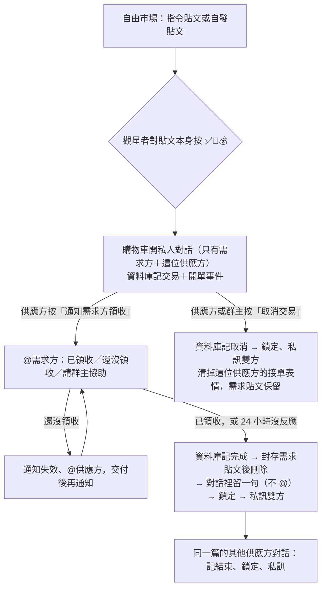
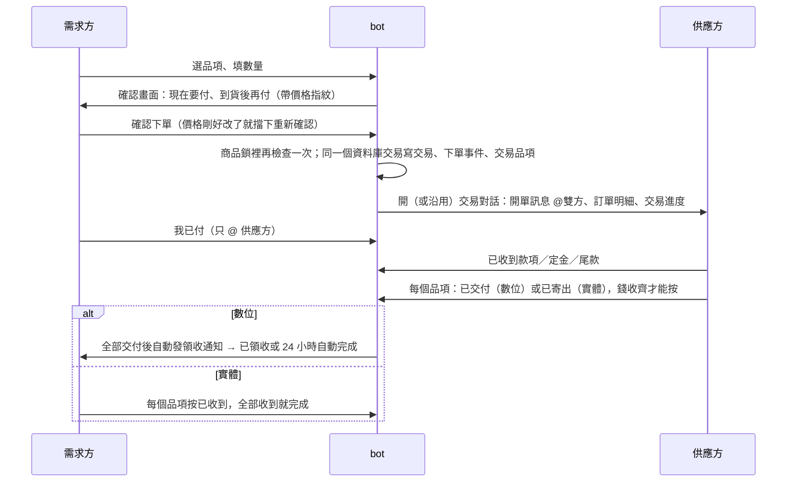

# 交易流程

> 決定與理由記在 `AI_HANDOFF_AND_TODO.md` 的「交易功能改版」區塊（trade-revamp）。這份寫現在的程式怎麼運作。

行號會隨改動漂移，請以函式名稱為準。圖是 Mermaid，GitLab 會直接顯示；VS Code 要裝 `bierner.markdown-mermaid` 擴充，預覽裡才看得到圖。

## 用語

交易不一定是買賣，所以不叫買家、賣家。給群友看的字只用下面這幾個。

| 用語 | 意思 | 程式裡的名字 |
|---|---|---|
| 自由市場 | 交易論壇頻道 | `trade_forum_channel_id` |
| 需求貼文 | 自由市場裡的一篇貼文。分成**指令貼文**（`/select_item` 由 bot 代發，內文 @ 需求方）和**自發貼文**（使用者自己發） | `source_id` |
| 商品論壇、商品 | 觀星者上架的論壇；一篇 bot 代發的貼文是一個商品，放一批東西 | `shop_forum_channel_id`、`Listing` |
| 品項 | 商品裡能單獨挑、單獨訂價和數量的一樣東西，最多 25 個 | `Variant` |
| 付款方式 | 品項的類型：立即購買、預購（有截止）、定金＋尾款（有收定金的截止） | `kind`：instant／preorder／deposit |
| 交付方式 | 每篇商品設一次：實體（要寄送）或數位（帳號、代儲、道具） | `delivery`：physical／digital |
| 需求方 | 自由市場：自發貼文的作者、指令貼文裡被 @ 的人；商品：下單的人 | `requester` |
| 供應方 | 自由市場：對需求貼文按接單表情的觀星者（Trader）；商品：上架那篇、能管理它的人 | `supplier`、`owner_id` |
| 交易對話 | 購物車頻道底下的私人 thread，只有需求方和這位供應方 | `trades.id`（＝thread id） |
| 交易進度 | 商品交易裡的一則卡片：每個品項付到哪、交到哪，下面是這一步能按的按鈕 | `shop_trade.render_card` |
| 領收 | 數位交付全部完成後的確認：需求方按「已領收」，或 24 小時沒反應自動完成（到期前 6 小時提醒一次）；「還沒領收」暫停 | `request_receipt_locked`、`hold_receipt` |
| 舊交易 | 上線匯入前就開著的交易，沒有交易進度、不發等待提醒，照舊流程完成或取消 | `trades.legacy` |

## 頻道與設定

| 設定鍵（`src/config.json`） | 頻道 | 類型 | 用途 |
|---|---|---|---|
| `trade_forum_channel_id` | 自由市場 | 論壇 | 需求貼文 |
| `shop_forum_channel_id` | 商品論壇 | 論壇 | 商品貼文、置頂「📌 上架說明」 |
| `cart_delivery_channel_id` | 🛒購物車 | 文字頻道 | 交易對話 |
| `archive_channel_id` | 封存 | 論壇（文字頻道也可以） | 自由市場成交的需求貼文副本、商品交易的留底 |
| `role_mapping.Trader` | 觀星者 | 身份組 | 接單、上架、設定價格 |

頻道都在 `src/settings/channel_registry.py` 登記，由 `/server_manager` 的「頻道設定」綁定，每次用到都重讀（5 分鐘快取）。其餘設定在 `sys_settings/trade_settings.py`（`TradeSettings`：接單表情、領收期限 24 小時、提醒 6 小時前）與 `sys_settings/shop_settings.py`（`ShopSettings`：一次最多買 5 種、最多 10 張圖、預設幣別 NT$、標籤「預購中」）。

## 程式碼清單

| 檔案 | 內容 |
|---|---|
| `src/services/market_db.py` | **市集資料庫**（SQLite，`src/services/market.db`）：商品、品項、交易、交易品項、交易事件、週報紀錄的正本；`backup_daily` 每天一份備份到 `src/services/market_backup/`、留 14 份 |
| `src/services/community/trade_service.py` | **交易模組**。`TradeService`：接單（`handle_reaction`）、開單（`open_trade`）、按鈕（`handle_button`）、領收、取消、完成、領收期限（`run_receipt_deadlines`）；`locked()` 拿交易鎖；`SourceKind` 是商品交易接進來的地方 |
| `src/services/community/trade_progress.py` | 純邏輯：從交易品項與事件算出每個品項的狀態、現在等誰、哪些動作允許（允許表）、等待提醒什麼時候該發 |
| `src/services/community/shop_listing.py` | 純資料與畫面：商品與品項的模型、供應方填的內容怎麼解析（「定金/尾款」）、商品貼文與選單、下單檢查、價格指紋 |
| `src/services/community/shop_service.py` | `ShopService`：上架、管理（新增／批次／編輯／刪除品項、編輯商品資訊、下架）、下單、截止、延期、開始收尾款、開始交貨、置頂說明 |
| `src/services/community/shop_trade.py` | `ListingTrades`（交易模組的來源種類「商品貼文」）：交易進度卡、付款與交付按鈕、截止／延期／請款通知、等待提醒、取消時還回數量、完成時留底 |
| `src/services/community/market_report.py` | 週報（週一 12:00 私訊有待辦的觀星者）、「📋 我的交易」、群主主控台的交易看板 |
| `src/services/community/market_import.py` | 上線匯入：舊商品貼文與還開著的交易對話一次搬進資料庫；舊格式的解析只在這裡 |
| `src/commands/forum_monitor.py` | Discord 介面（cog `ForumMonitor`）：接單表情、`TradeButton`、舊按鈕 `LegacyTransactionView`、新對話附上供應方價格表、領收期限的排程 |
| `src/commands/shop_commands.py` | Discord 介面（cog `ShopCommands`）：購買選單、管理面板與表單、交易進度按鈕（`ShopStepButton`）、置頂說明的「🛒 上架商品」「📋 我的交易」；上線匯入、截止、等待提醒、每日備份、週報五個排程 |
| `src/commands/admin_console.py` | 主控台的「交易看板」畫面 |
| `src/commands/trade_commands.py`、`user_commands.py` | `/select_item`、`/set_item_prices`、`/list_item_price`（價格表，跟交易對話無關） |
| `src/test/test_trade_flow.py`、`test_shop_flow.py`、`test_shop_listing.py`、`test_trade_progress.py`、`test_market_db.py` | 測試 |

## 資料在哪裡

**正本在資料庫，Discord 上的貼文與訊息都是從資料庫畫出來的。** 每個動作都是「在交易鎖裡讀資料庫 → 照允許表判斷 → 寫一筆事件 → 成功後才發 Discord」。Discord 發失敗時狀態還是對的，之後的動作會重畫。

| 表 | 一列是什麼 | 重點 |
|---|---|---|
| `listings` | 一篇商品（id＝論壇 thread id） | 供應方、標題、說明、幣別、交付方式、圖、是否下架、下一個品項編號（只增不減） |
| `variants` | 一個品項 | 類型、價格（定金＋尾款時是定金）、尾款、數量上限、`sold_before`（上線前賣掉的）、截止、截止處理過沒、預計交貨日、延期次數、開始收尾款的時間、是否刪除 |
| `trades` | 一個交易對話（id＝thread id） | 來源（商品或自由市場）、需求方、供應方、狀態（open／completed／cancelled／ended）、是否舊交易、目前那張交易進度的訊息 |
| `trade_items` | 一次下單裡的一個品項 | 份數、下單當時的單價與尾款、取消時還回幾份 |
| `trade_events` | 交易裡發生的一件事，只增不改 | 開單、下單、我已付、已收到定金／尾款／款項、請尾款、已交付、已寄出、已收到、領收通知、還沒領收、提醒、截止與延期通知、完成、取消；帶品項×份數、金額、誰按的、來源（`m`＝供應方確認，以後串金流是金流）、對應的訊息 |
| `weekly_reports` | 一份週報 | 哪一週、給誰、送到沒 |

- 已下單份數＝`sold_before`＋還算數的交易品項（取消還回的不算）。改價格只影響之後的新訂單。
- 按鈕的 custom_id 只用來找到元件：交易按鈕沿用 `trade:動作:來源:需求方:供應方`，交易進度的按鈕是 `trade:step:動作[:品項編號]`；身分一律照按鈕所在的對話查資料庫。
- 讀交易對話（翻 Discord 歷史）只剩兩個用途：上線匯入、交易結束時收掉按鈕，都經 `TradeService.read`。
- 名字一律用伺服器暱稱：先查成員快取，沒有再向 Discord API 查。

## 流程

### 1. 自由市場

### 2. 商品：上架與管理

管理面板只有供應方看得到，一則最多 5 列：新增品項／批次新增／編輯商品資訊；📅 延期＋📦 開始收尾款（準備交貨），一次付清的預購是 ⏩ 開始交貨；下架；編輯、刪除品項兩個選單。

- 上架表單：標題、說明、幣別、商品圖、交付方式（預設實體）。
- 品項表單：名稱、價格（定金＋尾款填「定金/尾款」，例 500/1300）、類型、截止、數量。批次新增一行一項「名稱｜價格｜數量｜截止」，價格有斜線就是定金＋尾款。
- 擋下來的：定金品項跟一次付清的放同一篇；交易中的品項改類型；有交易時改交付方式、刪那個品項；有人下單或已截止後改截止時間（要用延期）；還有定金或預購交易沒做完就下架。

### 3. 商品：下單與交易進度

- 開單訊息上的「通知需求方領收」＝剩下的品項一起交付，錢沒收齊照擋；需求方按過「還沒領收」，補交後再按一次就重新通知。
- 定金＋尾款：確認定金後「等貨」；供應方在管理面板按「開始收尾款」，這個品項停收定金，每個買了它的對話照下單時說好的尾款請款（定金還沒確認的對話請供應方先確認）。請款先記事件、發出去才補上訊息編號；沒發出去的由截止排程補發。
- 加購：同一位需求方、同一篇商品、對話還沒結束就沿用；原本的領收通知作廢，上一張交易進度的按鈕收起來。
- 取消：供應方或群主。有已收的款先跳確認，取消訊息與私訊提醒「定金已付」之類；沒交付、沒寄出的份數還回商品，已交付或寄出的不還。
- 完成：商品貼文保留；封存頻道另發「【市集】商品｜需求方 與 供應方」留底（每筆下單＋交易對話連結，不附對話內容：對話裡可能有帳號、付款、地址）。

### 4. 截止、延期、開始交貨

| | 一次付清的預購 | 定金＋尾款 |
|---|---|---|
| 截止那一刻 | 停止下單，每個對話 @ 雙方可以開始交貨 | 只停收定金，不 @ 人 |
| 延期（還沒截止） | 截止往後、收單跟著延長，@ 需求方 | 同左 |
| 延期（已截止） | 只設預計交貨日，不重新開放下單，@ 需求方 | 預計到貨日 |
| 提早開始 | ⏩ 開始交貨：現在就截止並通知 | 📦 開始收尾款 |

截止、延期通知先記事件再發：一個對話發不出去不影響別人，重啟也不會重複 @。

### 5. 通知

只 @ 下一步要動手的人；交易結束時對話裡不 @，改私訊雙方。等待提醒（`trade_progress.due_reminders`）：需求方沒付款 3 天後、之後每 7 天、最多 3 次；需求方說付了而供應方沒確認、或錢收齊還沒交付，3 天後 @ 供應方一次，之後只進週報；實體寄出第 7 天起每 3 天 @ 雙方。22:00～10:00 到期的順延到 10:00，同一個對話一天最多一則，舊交易不提醒。

週報每週一 12:00 私訊有待辦的觀星者（群主不收），週一 23:59 前開機會補發；觀星者隨時可以在置頂說明按「📋 我的交易」；群主在 `/server_manager` 的「交易看板」看每位觀星者的數字、認不出身分的舊交易、週報沒送到的。

## 上線匯入

`market_import.run_import` 在 bot 連上後跑一次：先把商品論壇裡的舊商品貼文（品項資料寫在選單選項的舊格式）與購物車裡還開著的交易對話讀完，在一個資料庫交易裡全部寫進去（交付方式一律數位、交易標成舊交易），再把每篇商品貼文照資料庫重畫成新格式，全部做完才打開按鈕。匯入中按商品或交易按鈕回「商品與交易功能更新中」。失敗時私訊群主，群主按「重新偵測」重跑，已經寫進去的不重寫。

## 坑

- 改商品貼文時**不能傳附件清單**：被 embed 引用的圖不在附件清單裡，照那份清單回傳，Discord 就會把圖刪掉。只傳 embed，用 `attachment://檔名` 引用。
- 封存中的 thread 改不了訊息：改之前用 `utils.discord_threads.reopen_thread` 解封，商品貼文改完再封存回去。發訊息本身會自動解封。
- Discord 的選單選過同一項就不會再通知 bot：商品貼文的購買選單在數量視窗跳出後重畫；管理面板每次操作完都重畫。
- 「預購中」標籤在綁定商品論壇時就建好，需要那個論壇的「管理頻道」權限；現在只給群友篩選用，截止看資料庫。
- 按鈕的外觀對所有人都一樣，「管理商品」大家都看得到，只有供應方與管理員按得動。
- 舊交易對話上的舊按鈕（`forum_trade_confirm`、`forum_trade_cancel`）由 `LegacyTransactionView` 接住，走同一套流程；舊交易都結束後可以刪掉它和 `legacy_ref_from_text`。
